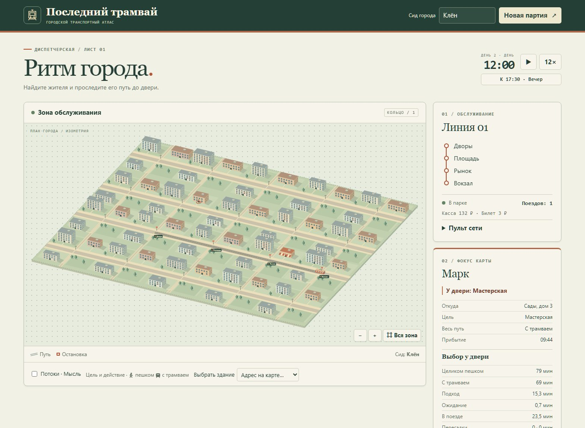

# Последний трамвай

Браузерная игра о том, кому пригодится ваш трамвай. Начните с одного поезда в центре, найдите человека, которому удобнее идти пешком, и решите, что изменить: рельсы, остановки, выпуск поездов или цену билета. Результат виден у двери назначения: пассажиру ещё надо дойти туда после высадки.

**[Играть в браузере — версия из `master`](https://troyan-dy.github.io/last-tram/)**.

**Играть локально:** для версии из PR возьмите ссылку на ZIP в его описании, для последнего выпуска — [ZIP `master`](https://github.com/troyan-dy/last-tram/archive/refs/heads/master.zip). Распакуйте архив целиком и откройте [`index.html`](index.html) двойным щелчком в браузере. Папка `game/` должна лежать рядом. Для локальной игры не нужны интернет, сервер, Node.js или установка пакетов.

## Первая партия

1. В поле **Сид города** введите `Клён` и нажмите **Новая партия**. Пустое поле даст случайный город. Сид напечатан под картой: введите его снова, чтобы попробовать другую сеть в том же городе. Партия начнётся заново.
2. Включите **Потоки · Мысль**. Выберите облачко на карте или имя в списке **В пути сейчас**. В карточке **Выбор у двери** сравните весь путь пешком и с трамваем. Пешеход, который идёт к остановке, уже выбрал трамвай. **Ⅱ** ставит город на паузу; **1×** меняет скорость, а **К 12:00** доводит город до следующего периода.
3. Откройте **Пульт сети**. Для изменения цены введите **Цену билета** и нажмите **Установить тариф**. Чтобы сократить ожидание, можно купить поезд на выбранный маршрут. Для продления линии сначала постройте участок рельсов, затем добавьте остановку в рабочий маршрут и нажмите **Сохранить остановки**.
4. Выберите адрес в **Выбрать здание**. В **Журнале прибытий** задайте день и период: строки показывают, из каких районов дошли до этой двери пешком и с трамваем. Выручка относится ко всей сети. Вечером найдите того же человека в списке **Наблюдать за жителем**: обратно он выходит из здания, в котором оказался днём.
5. В **Целях города** получите право на расширение: довезите до двери 3 пассажиров с трамваем **или** заработайте 16 ₽ на билетах. Открытие первого кольца стоит отдельно 80 ₽. Выберите, с какого нового района начать. Следующая цель — посадить жителя на остановке кольца и доставить до двери в центре. В целях останется запись о первой такой поездке: откуда, куда и когда прибыл пассажир. **Показать пассажира сейчас** выберет этого жителя на карте, даже если он уже возвращается домой.

Нажмите на поезд или знак остановки: под картой появятся сведения о сети, а выбранный житель или фильтры здания останутся на месте. Если несколько человек стоят вместе, нажмите на фигуру и выберите имя в **Жители в этой точке**. Колесо приближает место под курсором; на приближённой карте перетаскивайте план. На узком экране используйте **+**, списки под картой и **Вся зона** для возврата к обзору.

[](docs/playtests/ring-passenger-sady.jpg)

[Ход проверенной партии на Клёне](docs/playtests/network.md#проверенная-партия-клён): почему Вера пошла пешком, что показал журнал и кого повезла новая линия.

## Для разработки

В клоне репозитория из корня выполните:

```sh
npm ci
npx playwright install chromium
npm test
```

`npm test` запускает все проверки модели и браузера. По отдельности:

```sh
node --test tests/*.test.js
npx playwright test tests/gameplay.spec.js
```

Последняя команда создаёт ZIP командой `git archive` из текущего **коммита**, распаковывает его в новую временную папку и проходит игру в Chromium с отключённой сетью. Нужны Git и распаковщик (`tar` в Windows, `unzip` в Linux/macOS). Чтобы собрать такой ZIP для игры вручную:

```sh
git archive --format=zip --prefix=last-tram/ --output=last-tram.zip HEAD
```

## Материалы проекта

- [Решения по игре](docs/adr/README.md) и [словарь](GLOSSARY.md).
- Архив: [`prototype-city-day.html`](prototype-city-day.html) — визуальные этюды; [`prototype-station-flow.html`](prototype-station-flow.html) — ранний прототип диспетчерской. История [дизайна одного вагона](docs/concept.md) и [визуальных вариантов](docs/next-session.md) хранится отдельно от основной игры.
