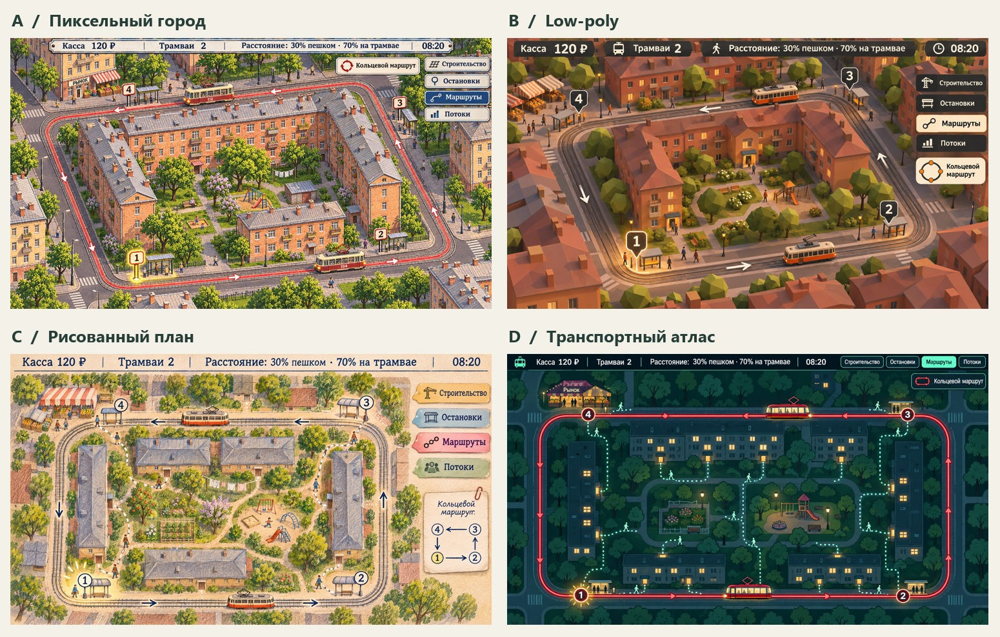

# Четыре эскиза одного игрового экрана

Оригиналы из генератора изображений ChatGPT, 1672 × 941: [A · пиксельный город](chatgpt-art/A-pixel.png), [B · low-poly](chatgpt-art/B-low-poly.png), [C · рисованный план](chatgpt-art/C-paper.png), [D · ночной атлас](chatgpt-art/D-atlas.png). Это варианты для сравнения, визуальный стиль игры пока не выбран.

Для каждого изображения передать генератору **общую сцену и один вариант оформления**. Нужен один игровой экран на изображение. Это поиск визуального стиля: ракурс 39° выбран в интерактивном макете, но не ограничивает поиск.

## Общая сцена

Нарисуй экран браузерной игры «Последний трамвай», горизонтальный формат 16:9. Игрок управляет городской трамвайной сетью. Карта занимает всё окно. В городе различимы рынок с навесом, жилые дворы, площадь, рельсы, пешеходы и два трамвая. Город живёт под интерфейсом; это снимок партии, без логотипа на пол-экрана, рамки устройства и рекламного текста.

На всех эскизах один момент: игрок задал четыре остановки щелчками по карте и собирается нажать первую ещё раз, чтобы замкнуть маршрут. Номера 1–4 стоят непосредственно у остановок. Покажи рельсы непрерывной петлёй вдоль улиц, стрелками — одно направление по кругу. В других режимах игрок строит участок между соседними остановками, смотрит обслуживание остановки или выясняет, из какого района и куда идут люди. Карту передвигают перетаскиванием.

Сверху с первого взгляда читаются «Касса 120 ₽», «Трамваи 2», «Расстояние: 30% пешком · 70% на трамвае», «08:20». Проценты обозначают расстояние жителей, включая пеший подход и выход: не число поездок и не время. Справа четыре компактные подписанные кнопки: «Строительство», «Остановки», «Маршруты», «Потоки». Активны «Маршруты»: рядом небольшая карточка «Кольцевой маршрут» поверх карты. Не рисуй постоянно развёрнутую боковую панель или выпадающий список остановок.

## Один из четырёх вариантов

| Эскиз | Команда генератору |
| --- | --- |
| **A · Пиксельный город** | Сделай рукотворный пиксель-арт в духе транспортных игр 1990-х: отчётливые пиксельные силуэты, кирпич и шалфей, кремово-красный вагон, различимые на тротуарах маленькие фигурки. Объёмная проекция, ближний угол слева, ориентир 39°. Оформи верхнюю строку как тёмную эмалевую табличку депо; подписи и цифры легко читаются. |
| **B · Low-poly** | Построй город как архитектурный макет: гранёные кроны, простые объёмы зданий, терракота и прохладные тени, оранжевый трамвай. Камера сверху под углом, ближний угол слева. Верхняя панель — лёгкие графитовые плашки с крупными цифрами. Улицу с рельсами видно между домами. |
| **C · Рисованный план** | Посмотри на тот же квартал строго сверху: крыши, рыночный навес и пешеходные дорожки без фасадов и перспективы. Гуашь на светлой бумаге, зелёные дворы, короткие пунктирные подходы от домов к остановкам. Интерфейс как поля городского путеводителя: тёмно-синие надписи, тонкие линейки, цветные закладки режимов справа. |
| **D · Транспортный атлас** | Изобрази плоскую ночную схему: тёмный сине-зелёный фон, приглушённые контуры кварталов, киноварная трамвайная линия со светлыми узлами, мятные пешие следы. Поезд и пешеход различимы без цветовой подсказки. Интерфейс напоминает навигацию станции, а схема остаётся обитаемым городом, не графиком. |

При сравнении можно выбрать город из одного эскиза, интерфейс из другого. Практическая проверка: сразу ли видно, сколько денег в кассе, где идёт человек и на какую остановку нажать, чтобы закончить кольцо?
