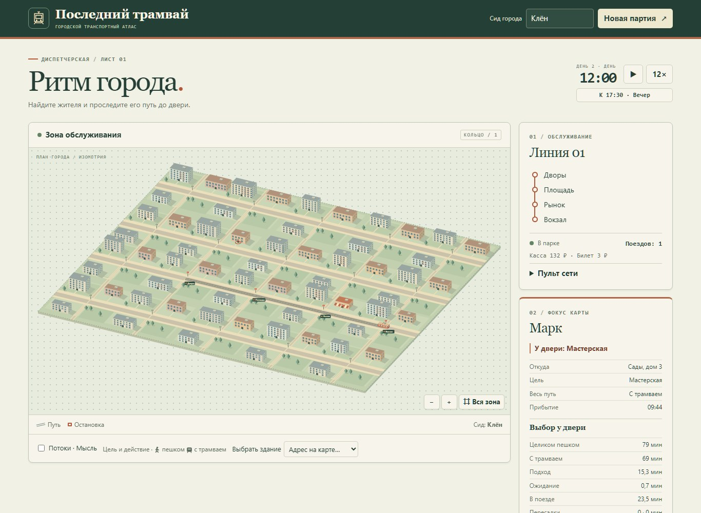

# Плейтест трамвайной сети

## Проверенная партия: Клён

23 ноября 2026 года. [Вход в игру](../../index.html) · [Как распаковать и запустить](../../README.md). Один сквозной автоматический прогон в Chromium на экране **390 × 844**: от первой прогулки в центре до пассажира на новой линии. Ниже — фактические результаты и действия, которыми их можно повторить.

| Когда | Действие и наблюдение |
| --- | --- |
| День 1, около 07:41 | Начать **Новую партию** с сидом `Клён`. На **1×** включить **Потоки · Мысль** и поставить на паузу, когда в **В пути сейчас** появится **Вера → Ателье · Идёт к двери · пешком**. Выбрать её: от **Липовая, дом 1** до ателье пешком **36,2 мин**, с трамваем **66,2 мин**. Причина: **«Далеко идти до остановки или от неё»**. Один подход занимает 28 мин, от высадки до двери — ещё 22,7 мин. |
| 12:00 | На той же паузе открыть **Пульт сети**, изменить **Цену билета** с 2 до **3 ₽**, нажать **Установить тариф**, затем **К 12:00**. У Веры осталась оценка с билетом 2 ₽: она уже вышла. Фактическое прибытие пешком к двери ателье — **08:17**. Выбрать **Ателье** в списке зданий и открыть журнал за утро (ниже). |
| 17:30 → 21:30 | Снова выбрать **Вера · Липовая, дом 1** в списке **Наблюдать за жителем**. К 17:30 она уже **у двери Почты**: пришла из ателье в **13:00**. На этот раз для трамвая пришлось бы ждать 25,2 мин. Продолжить на **4×**: около 17:41 её карточка показывает **Почта → Липовая, дом 1**. Поставить на паузу и нажать **К 21:30**. Вечернее прибытие домой — **18:40**, целиком пешком. |
| 21:30, ночь | В **Целях города** — 24 завершённых пути с трамваем в центре, 66 ₽ выручки, 146 ₽ в кассе. Нажать **Открыть кольцо · 80 ₽**. Осталось **66 ₽**; кнопка покупки исчезла, новая цель пока **0 из 1**. Сохранились тариф 3 ₽, тот же поезд и остановки **Дворы → Площадь → Рынок**. |
| На той же паузе | В **Пульте сети** выбрать **Новый участок → Рынок — Вокзал** и **Построить путь · 12 ₽**. На **Линии 01** выбрать **Добавить остановку → Вокзал → Добавить → Сохранить остановки**. Теперь Вокзал четвёртый; поезд покупать не требуется. |
| День 2, 07:30 → 12:00 | Нажать **К 07:30**, выбрать **Марк · Сады, дом 3**, продолжить на **12×**. Видны **В вагоне → Идёт к двери → У двери: Мастерская**. После высадки цель ещё **0 из 1**. Марк сел на Вокзале и пришёл в мастерскую в **09:44**: **69 мин** вместо **79 мин** пешком. К полудню это единственная поездка, выполнившая цель. Выбрать **Ася · Вокзал, дом 3**: она пошла на рынок пешком, выигрыш в полминуты не оправдал билет. **Показать пассажира сейчас** в целях возвращает к Марку. |

**Журнал двери «Ателье», день 1, 07:30–09:00** (09:00 не входит). Район — откуда житель вышел; способ — за весь путь.

| Район отправления | Пешком | С трамваем |
| --- | ---: | ---: |
| Липовая | 2 | 0 |
| Типография | 1 | 0 |
| Площадь | 2 | 0 |

Прибытий **5**, среднее фактическое время от двери до двери **29,2 мин**. Выручка **всей сети** за этот период — **21 ₽**. В конце проверки повторно ввели сид с карты, дождались полудня со стартовым тарифом **2 ₽**: та же центральная карта без кольца, три исходные остановки, Вера снова пришла в ателье в 08:17. У этой двери снова 5 прибытий и 29,2 мин в среднем, но выручка сети — **18 ₽**. Изменение выручки здесь не означает, что кто-то стал быстрее добираться в ателье.

**Как получено.** [Сквозной тест](../../tests/gameplay.spec.js) упаковывает `HEAD` через `git archive --format=zip`, распаковывает ZIP в пустую временную папку и открывает её `index.html` по `file://`. Снимок и числа выше — из прогона `3efedb41` в Chromium 159.0.8154.6. Сеть в браузере отключена; сценарий проверяет отсутствие HTTP(S)-запросов. Время, тариф, строительство, выбор жителя и перезапуск — только через интерфейс. На ширине 390 px **+** изменил масштаб, **Вся зона** восстановила обзор купленного кольца, горизонтальной прокрутки не появилось. Для снимка та же партия на паузе показана при 1366 × 1000. [Архивный снимок Аси](ring-passenger.jpg) относится к прежней модели пеших путей (`e51fd501`). Шаги проверки — в [README](../../README.md#для-разработки).

**Сравнение двух утр, сид `ТРАМ-17`, Крытый рынок, 07:30–09:00.** С одним поездом пришли 5 жителей пешком и 2 с трамваем; средний путь 41,6 мин, выручка сети 22 ₽. С двумя поездами пришли 4 пешком и 3 с трамваем; средний путь 39 мин, выручка сети 24 ₽. Число прибывших в обоих случаях — 7.

**Наблюдения за новым игроком:** не проводились. Автопроверка показывает, что действия выполнимы, но не измеряет, найдёт ли человек причину выбора и полезный маршрут без подсказки.

## Материалы для следующих плейтестов

Ниже — исходные гипотезы, примеры и вопросы для наблюдения за игроком. Принятые решения и их причины — в [журнале ADR](../adr/README.md).

## Задача игрока

Пустая остановка может означать две разные вещи: сюда почти никто не идёт или сюда идёт весь район, но пешком получается удобнее. Игроку нужно различить эти случаи и решить, куда потратить ограниченные деньги. Полный вагон и число проданных билетов сами по себе не отвечают на главный вопрос: стало ли жителям проще добираться до нужных мест?

## Пример для проверки

Например, жительнице до рынка 18 минут пешком. С трамваем дорога занимает 14 минут: три до остановки, четыре в ожидании, пять в вагоне и две от остановки до рынка. Если четыре сэкономленные минуты не стоят билета, она идёт пешком. Игрок может снизить цену или добавить поезд на маршрут, чтобы сократить ожидание. Результат виден у рынка: кто приехал, кто пришёл и откуда. Числа иллюстрируют выбор, а не задают порог модели.

## Пользовательские истории

1. Как игрок, я хочу начать со случайного сида города, чтобы искать полезные маршруты на незнакомой карте.
2. Как игрок, я хочу повторно ввести знакомый сид, чтобы попробовать другую сеть в той же географии.
3. Как игрок, я хочу начать с небольшой центральной зоны обслуживания, чтобы разобраться в первых потоках до расширения города.
4. Как игрок, я хочу видеть людей, которые идут пешком, чтобы замечать спрос до строительства путей.
5. Как игрок, я хочу выбрать жителя и узнать, откуда и куда он направляется, чтобы понять, какую связь ему можно предложить.
6. Как игрок, я хочу узнать причину его выбора, чтобы отличить долгое ожидание от дорогого билета или далёкой остановки.
7. Как игрок, я хочу выбрать место назначения и сравнить прибытия за один период по районам отправления и способам перемещения, чтобы проверить, типична ли проблема одного жителя.
8. Как игрок, я хочу проложить путь до нового места, чтобы связать его с существующей сетью.
9. Как игрок, я хочу назначать и менять порядок остановок на существующих путях, чтобы проверять другие маршруты без повторного строительства тех же рельсов.
10. Как игрок, я хочу использовать общий участок пути для нескольких маршрутов, чтобы обслуживать разные направления.
11. Как игрок, я хочу добавить поезд на выбранный маршрут, чтобы сократить интервал и время ожидания там, где это нужнее.
12. Как игрок, я хочу менять тариф и наблюдать за выбором жителей и выручкой, чтобы сопоставлять доступность поездки с возможностью оплатить развитие сети.
13. Как игрок, я хочу видеть завершённые перемещения и время до места назначения, чтобы отличать полезную поездку от лишней пересадки.
14. Как игрок, я хочу выбирать, потратить ли выручку на пути, поезда или доступное расширение, чтобы развивать сеть в удобном мне порядке.
15. Как игрок, я хочу при расширении открыть всю территорию до следующей границы, чтобы самому выбрать, куда сначала провести маршрут.
16. Как игрок, я хочу получать цели, связанные с реальными потоками новой территории или с выручкой, чтобы решать проблему своим способом.

## Гипотезы для плейтеста

| Что пробуем | Что хотим узнать |
| --- | --- |
| Единый тариф на сеть; несколько вариантов чувствительности к цене | Может ли игрок предсказать, кто продолжит ходить пешком после подорожания, и объяснить почему? Ни формула, ни коэффициенты, ни индексация не утверждены. |
| Разная ширина кольца, размер стартовой зоны и цена расширения | Замечает ли игрок новые потоки и может ли выбрать первую полезную связь? Рост радиуса примерно на 30% — пример для сравнения, не требование. |
| Повышение даёт право на покупку, а покупку оплачивает игрок | Для первого прогона город предлагает альтернативы, например сократить время дороги или увеличить выручку. Выполнение одной цели даёт право купить кольцо; одних денег недостаточно. Понятна ли разница между правом и самой покупкой? Сохраняется ли интересный выбор, когда потратить деньги? |
| Дополнительная аналитика открывается через исследование | Помогает ли сравнение утренних и вечерних потоков принять новое решение? Основные причины выбора жителя и статистика прибытий доступны и без исследования. |

Численные цели, состав заданий и темп повышений подбираются на играх с разными сидами; конкретный ЖК, завод или вокзал не обязательны на каждой карте.

## Проверка через действия игрока

Единая точка проверки — **наблюдаемая партия на известном сиде**. Смотрим на поведение городской карты, сети, перемещений жителей, выручки и расширения через доступные игроку действия. Для сравнения с ранним замыслом сохранены [бумажная версия](../concept.md) и [архивный прототип диспетчерской](../../prototype-station-flow.html).

**Исходный кадр для сравнения:** [игра, сид «Клён», 07:30](first-morning.jpg). На [карте](../../index.html) можно проследить пути от «Дворов» через «Площадь» до «Рынка». Приблизьте курсором Миру на тротуаре и выберите её: один и тот же житель должен оставаться в фокусе в поезде, после высадки и у двери рынка. Этот проход проверен в Chromium; понятность для впервые играющего человека оценивается отдельно.

- **Маршрут и тариф.** Найти пеший поток к рынку, выбрать жителя, назвать причину и изменить один фактор: тариф или интервал движения. Сравнить прибытия и выручку за сопоставимые периоды. Проверяем, изменилось ли поведение тех, для кого поездка стала выгоднее, а не точную долю пересевших. Поездка с пересадкой даёт одно прибытие в конечную точку.
- **Сид и кольцо.** Начать две партии с одним сидом. Сравнить стартовую географию и территорию после первого расширения: места назначения остаются на своих местах, а за одну покупку граница отодвигается со всех сторон, сохраняя уже построенную сеть.
- **Повышение — проверка гипотезы.** В пробном варианте сравнить три состояния: достаточно денег без выполненной цели; цель выполнена, но денег мало; выполнены оба условия. Только в третьем случае покупка доступна, и карта расширяется лишь после решения игрока.
- **Признак удачного плейтеста.** Игрок без подсказки находит причину пешего потока, проверяет догадку изменением сети или тарифа, а после расширения может назвать, кого повезёт первым и почему. Внутренний алгоритм, порядок вычислений и конкретные коэффициенты предметом проверки не являются.

## Один квартал в разное время суток

На одной и той же улице сравнить утро, день, вечер и ночь. Сначала смотреть на людей: с какой стороны они подходят к остановке и куда идут мимо неё? Затем — на свет: видны ли в сумерках житель, вход в вагон и знак остановки? Если час угадывается по окнам, но направление потока приходится читать в подписи, свет уже работает, а движение ещё нет.

В этюде можно выключить вечерний обратный пик, чтобы сравнить два кадра с одинаковой численностью людей. Для игры выбрали [обратные поездки тех же жителей](../adr/0007-daily-demand.md). Часы и высота пиков, дневные цели и число ночных перемещений ещё не подобраны.

**Намерения над головами.** Нина идёт весь путь пешком, Олег — к остановке перед посадкой, Мира — от остановки после высадки. Только Нина входит в пеший поток. В слое «Потоки» сравниваем облачко с картинкой цели, билет с названием и полоску этапов пути. Можно ли без выбора человека сказать, кто направляется к рынку, чем добирается и что делает сейчас? У Миры после высадки должен измениться только этап, а в толпе должно быть ясно, кому принадлежит метка.

### Потоки у здания

После выбора облачка проверяем фильтр на одной и той же улице. Нажать на рынок: «К зданию» отбирает перемещения, у которых рынок — конечная точка, «Из здания» — те, которые **начались** на рынке. Просто пройти мимо рынка недостаточно. Направления и способы («целиком пешком», «с трамваем») можно включать независимо. Например, «К зданию» + «С трамваем» сохраняет Миру в выборке и в поезде, и после высадки до входа на рынок. Это люди в пути сейчас; статистика фактических прибытий за период отвечает на другой вопрос.

Жители вне выборки остаются в кадре без облачков ([ADR 0003](../adr/0003-visible-demand.md)). На одном кадре с Мирой в выборке переключить «Приглушать жителей без облачков»: помогает ли полупрозрачность найти её в толпе или достаточно самих облачков? Нужна ли полоска этапов C, когда направление и способ уже отобраны?

**Смена фокуса.** У рынка оставить «К зданию» и «С трамваем», затем нажать на Нину без облачка. Теперь выбрана Нина, видны её исходная точка, цель и способ перемещения. Снова выбрать рынок: видны оба направления и оба способа. Повторить переход нажатием на облачко Миры или на её имя в списке: результат не зависит от того, как выбрали жителя.

## Видимость путей в центре

Открыть новую игру на разных сидах. На исходном общем плане найти две остановки и провести взглядом вдоль рельсов между ними, в том числе за передним рядом домов. Если для этого приходится приближать карту или наводить курсор на дом, квартал не отвечает [критерию застройки](../adr/0006-isometric-city.md). Полупрозрачный дом при наведении остаётся отдельной идеей; сам по себе он эту проверку не проходит.

## Что пока не определено

Материалы, точная палитра и детализация спрайтов открыты. Для слоя «Потоки» уже выбраны [облачко и правила фокуса](../adr/0003-visible-demand.md); оформление статистики и полезность дополнительных обозначений остаются вопросами плейтеста.

Нагрузка на больших картах и условия конца партии за пределами первого кольца остаются открытыми вопросами. Пошаговая головоломка про один вагон и десять перегонов — ранний вариант, а не ограничение тайкуна.

## Открытые вопросы о правилах игры

Видны ли перемещения через границу закрытого кольца? Может ли полный вагон оставить жителя ждать следующий? Требует ли работа пустого маршрута текущих расходов? Можно ли прокладывать пути вне улиц? Эти правила меняют доступные игроку решения и требуют отдельного обсуждения.
